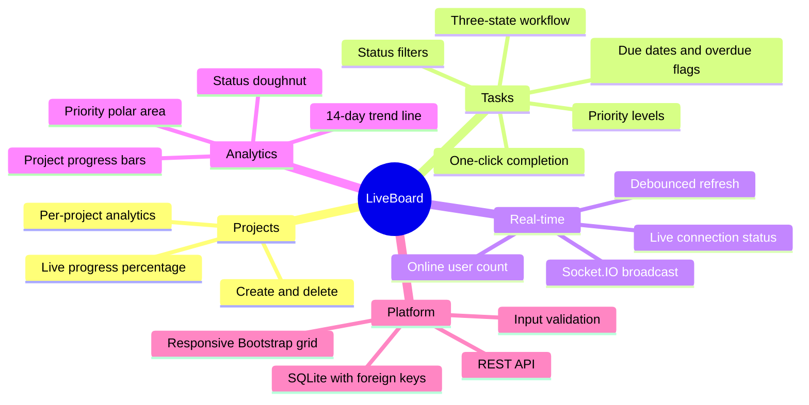
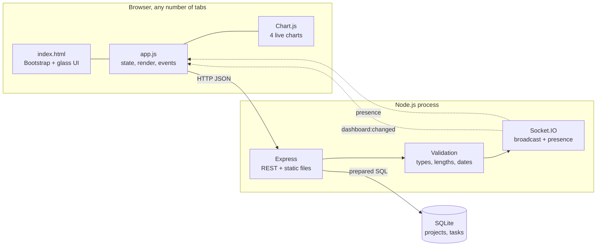
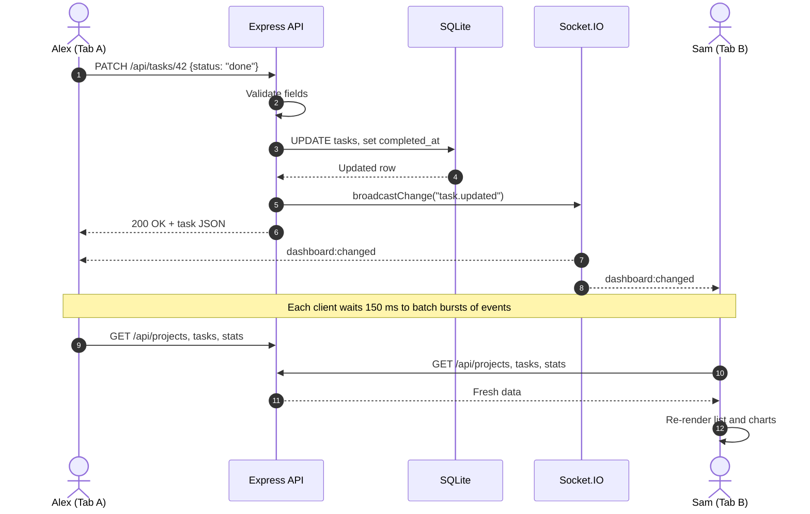
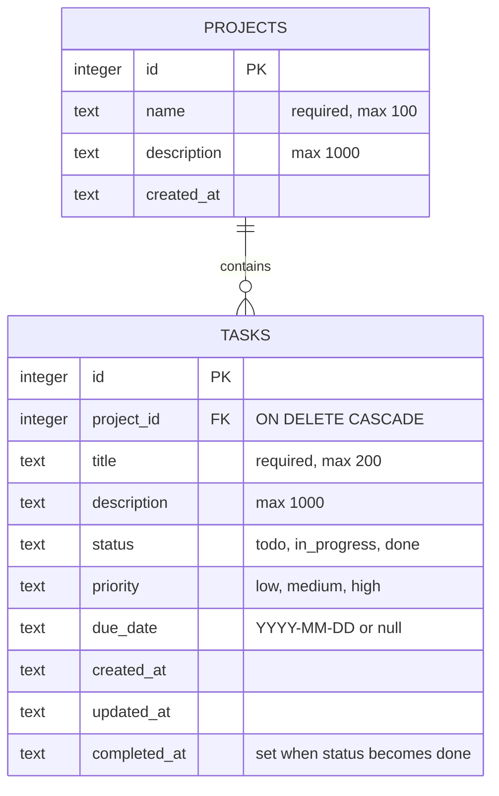
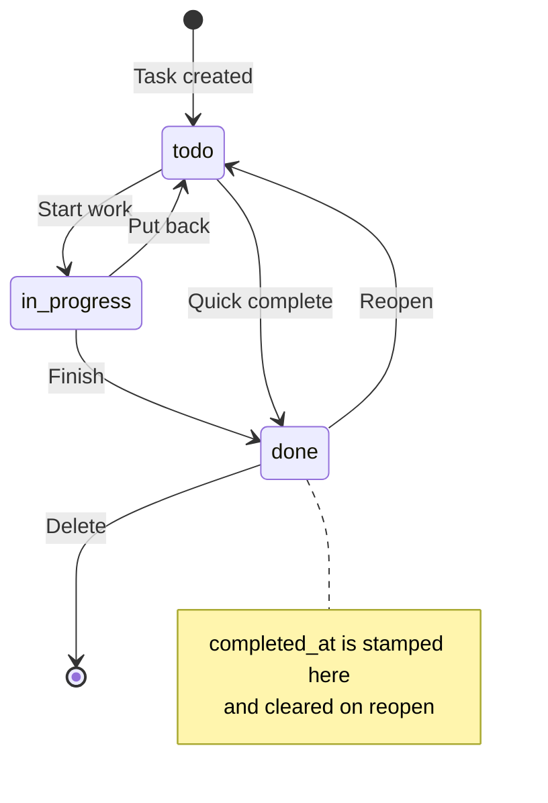
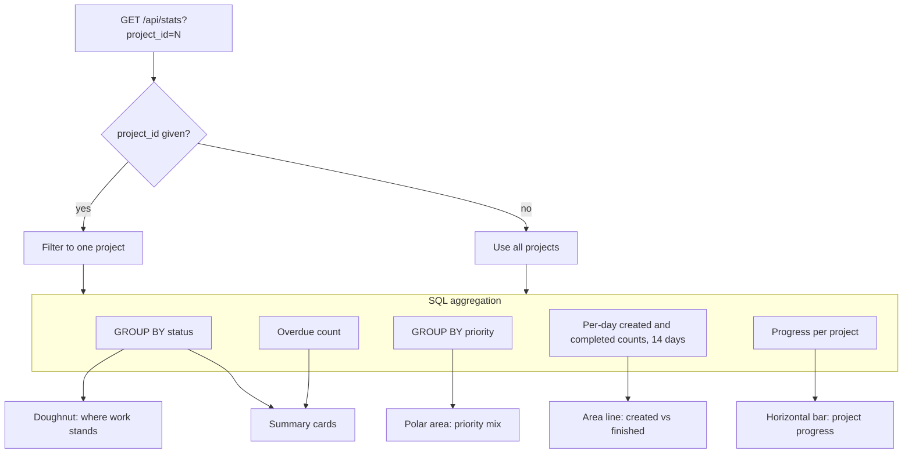
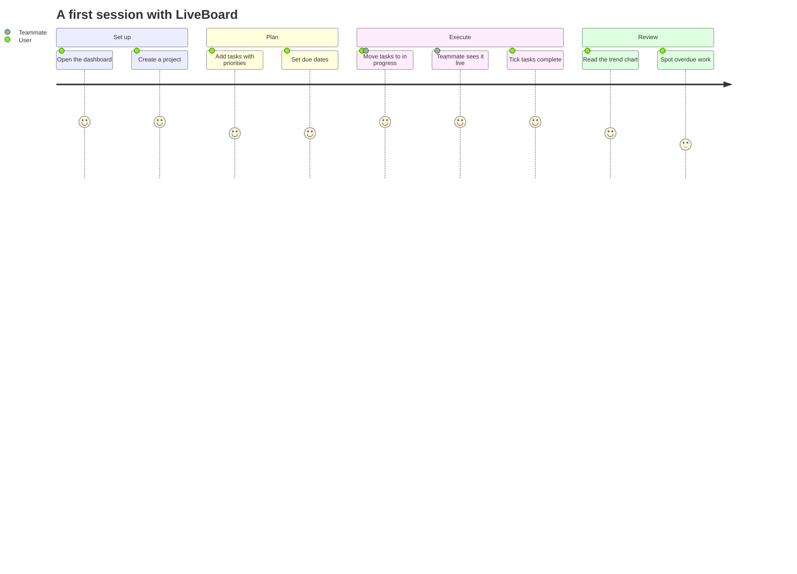
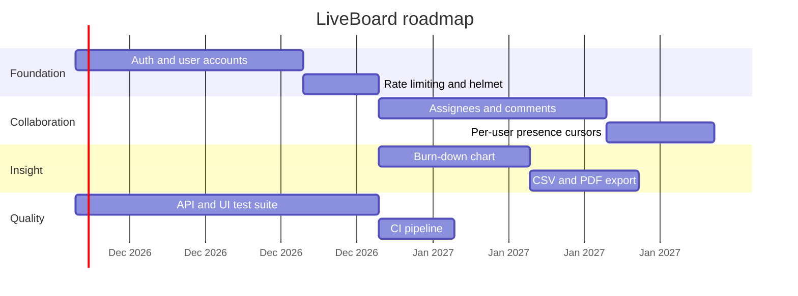

<div align="center">

# LiveBoard

**A real-time task and project dashboard.** Create projects, track tasks, and watch every open tab update the instant something changes.


[Quick start](#-quick-start) · [Architecture](#-architecture) · [API](#-rest-api) · [Real-time](#-real-time-layer) · [Design system](#-design-system) · [Roadmap](#-roadmap)

</div>

---

## Why LiveBoard

Most task trackers either feel like spreadsheets or need a full SaaS stack to run. LiveBoard is a small, readable codebase (three files) that still delivers what a team actually needs:

- **Shared state, instantly.** Change a task in one tab and every other client refreshes over WebSockets.
- **Progress you can see.** Four chart types turn task data into status, priority, per-project and trend views.
- **Runs anywhere.** One Node process and one SQLite file. No external database or build step.
- **Responsive by default.** A glassmorphism interface that collapses cleanly from desktop to phone.

## Feature map



## Tech stack

| Layer | Technology | Role |
|---|---|---|
| Runtime | Node.js 18+ | Server runtime (uses `Object.hasOwn`) |
| HTTP | Express | REST API and static hosting |
| Real-time | Socket.IO | Change broadcast and presence |
| Database | SQLite via `better-sqlite3` | Synchronous SQL, WAL mode, foreign keys |
| UI | Bootstrap 5.3 + custom CSS | Grid, forms, glass surfaces |
| Charts | Chart.js 4 | Doughnut, polar area, bar, line |
| Type | Bricolage Grotesque, Figtree | Headings and body |

## Architecture



## How a change reaches every screen



## Data model



Deleting a project removes its tasks through the foreign-key cascade. An index on `tasks(project_id, status)` keeps the per-project queries fast.

## Task lifecycle



## Chart data pipeline



## User journey



## Quick start

**Prerequisites:** Node.js 18 or newer.

```bash
# 1. Install dependencies
npm init -y
npm install express socket.io better-sqlite3

# 2. Lay out the files
#    server.js
#    public/index.html
#    public/app.js

# 3. Run
node server.js
```

Open <http://localhost:3000>. Open a second tab next to it, change a task, and watch both update.

Add this to `package.json` if you want `npm start`:

```json
{
  "scripts": { "start": "node server.js" }
}
```

### Configuration

| Variable | Default | Description |
|---|---|---|
| `PORT` | `3000` | HTTP and WebSocket port |
| `DB_PATH` | `./data/dashboard.db` | Location of the SQLite file (created automatically) |

```bash
PORT=8080 DB_PATH=/var/lib/liveboard/app.db node server.js
```

### Project structure

```text
liveboard/
├── server.js          Express API, SQLite schema, Socket.IO
├── public/
│   ├── index.html     Layout, design tokens, glass styles
│   └── app.js         State, rendering, charts, socket client
└── data/
    └── dashboard.db   Created on first run
```

## REST API

All bodies are JSON. Validation errors return `400` with `{ "error": "..." }`, and unknown ids return `404`.

| Method | Endpoint | Purpose |
|---|---|---|
| `GET` | `/api/projects` | List projects with task counts and progress |
| `POST` | `/api/projects` | Create a project (`name`, `description`) |
| `DELETE` | `/api/projects/:id` | Delete a project and its tasks |
| `GET` | `/api/projects/:id/tasks` | List tasks, open ones first, then by priority |
| `POST` | `/api/projects/:id/tasks` | Create a task (`title`, `description`, `priority`, `due_date`) |
| `PATCH` | `/api/tasks/:id` | Update any of `title`, `description`, `status`, `priority`, `due_date` |
| `DELETE` | `/api/tasks/:id` | Delete a task |
| `GET` | `/api/stats` | Chart data; add `?project_id=` to scope it |

### Try it

```bash
# Create a project
curl -X POST localhost:3000/api/projects \
  -H "Content-Type: application/json" \
  -d '{"name":"Launch","description":"Ship v1"}'

# Add a task
curl -X POST localhost:3000/api/projects/1/tasks \
  -H "Content-Type: application/json" \
  -d '{"title":"Write release notes","priority":"high","due_date":"2026-12-01"}'

# Mark it done
curl -X PATCH localhost:3000/api/tasks/1 \
  -H "Content-Type: application/json" \
  -d '{"status":"done"}'
```

## Real-time layer

| Event | Direction | Payload | Meaning |
|---|---|---|---|
| `dashboard:changed` | server → all clients | `{ type, at }` | A project or task was created, updated or deleted |
| `presence` | server → all clients | `{ online }` | A client connected or disconnected |

`type` is one of `project.created`, `project.deleted`, `task.created`, `task.updated`, `task.deleted`.

Design choices worth knowing:

- **Signal, not payload.** The server broadcasts that something changed and clients refetch. This keeps every client consistent with the database and avoids merge logic.
- **Debounced refresh.** The client waits 150 ms before refetching, so a burst of changes triggers one reload.
- **Visible connection state.** The header pill shows live or reconnecting, so users know whether they are seeing current data.

## Design system

LiveBoard deliberately avoids the default blue SaaS look. It uses a plum-black base with warm, distinct accents, and frosted glass panels (`backdrop-filter`) over soft colour glows.

| Token | Hex | Used for |
|---|---|---|
| Ink | `#150e1d` | Page background |
| Plum | `#231733` | Raised surfaces and toasts |
| Mist | `#f3ecf7` | Primary text |
| Sea | `#5fd6bf` | Done, progress, live status |
| Saffron | `#f4b942` | In progress, medium priority, primary buttons |
| Rose | `#ef6f88` | High priority, overdue, destructive actions |
| Lilac | `#b9a2f2` | To do, low priority |

Typography pairs **Bricolage Grotesque** for headings with **Figtree** for body text. Motion is limited to progress fills, a new-task highlight and the live pulse, and it switches off when the user prefers reduced motion.

## Security and quality notes

- **Parameterised SQL** everywhere, so user input is never concatenated into queries.
- **Server-side validation** for lengths, enums and `YYYY-MM-DD` dates, with a check that rejects impossible dates.
- **Output escaping** on the client for every user-supplied string rendered as HTML.
- **Foreign keys on** and cascading deletes, so no orphaned tasks.
- **Keyboard-visible focus**, labelled controls and ARIA live regions for toasts.

**Not included yet:** authentication, per-user permissions and rate limiting. Put LiveBoard behind a trusted network or a reverse proxy with auth before exposing it publicly.

## Deploy with Docker

```dockerfile
FROM node:22-slim
WORKDIR /app
COPY package*.json ./
RUN npm ci --omit=dev
COPY . .
ENV PORT=3000 DB_PATH=/data/dashboard.db
VOLUME /data
EXPOSE 3000
CMD ["node", "server.js"]
```

```bash
docker build -t liveboard .
docker run -p 3000:3000 -v liveboard-data:/data liveboard
```

Run a single instance. SQLite and the in-process Socket.IO server are designed for one process; scaling out would need a shared database and the Socket.IO Redis adapter.

## Roadmap

A proposed plan, not a commitment.



## Contributing

1. Fork the repository and create a branch: `git checkout -b feature/my-change`
2. Keep changes focused, and match the existing style (plain JavaScript, no build step).
3. Test the real-time path with two browser tabs open.
4. Open a pull request describing what changed and why.

## License

Released under the MIT License. Add a `LICENSE` file with your name before publishing.

---

<div align="center">

Built with Node.js, SQLite and a lot of care for the details.

</div>
